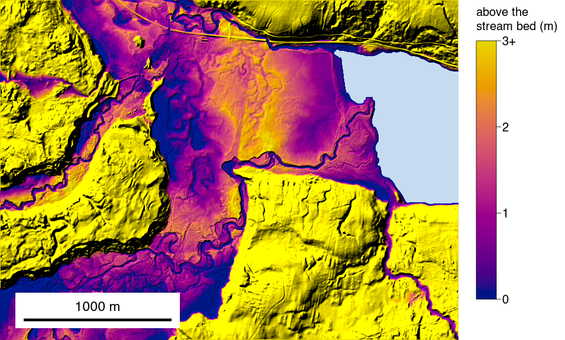

```{r setup, echo=FALSE, include=TRUE}
knitr::opts_chunk$set(echo = TRUE, message = FALSE, warning = FALSE, dpi = 60,
                      out.width = "100%")
```

```{r source, echo=FALSE, include=FALSE}
suppressMessages(library(sf))
sf::sf_use_s2(FALSE)
source("scripts/readme_functions.R")

# DT names each widget container `htmlwidget-<random hex>`. Seeded, a re-render rewrites
# index.html only when the data moved (stac_floodplains_bc).
set.seed(42)
htmlwidgets::setWidgetIdSeed(42)
```

```{r build, echo=FALSE, eval=FALSE}
# Both targets come from this file. `rmd_on` switches what differs between them;
# `update_query` decides whether the network is used at all.
#
#   update_query = TRUE   the API, two header reads, the DEM, CHM and valley-floor
#                         demos -> data/readme_cache.rds, data/readme_dem.json,
#                         fig/kanaka_dem.png, data/readme_chm.json, fig/maxan_chm.png,
#                         data/readme_rem.json, fig/maxan_rem.png
#                         (the CHM demo downloads ~0.5 GB of .laz to data/readme_laz/ once)
#   update_query = FALSE  the cache only; no network
#
# Run the md first: it is the one that refreshes the cache the html then reads.
rmarkdown::render(
  "README.Rmd",
  output_format = "github_document",
  params = list(rmd_on = FALSE, update_query = TRUE)
)

rmarkdown::render(
  "README.Rmd",
  output_format = "html_document",
  output_file = "index.html",
  params = list(rmd_on = TRUE, update_query = FALSE)
)
```

```{r example-run, ref.label=c("example", "header"), echo=FALSE, include=FALSE, eval=isTRUE(params$update_query)}
```


```{r query, echo=FALSE, include=FALSE}
if (isTRUE(params$update_query)) {
  # The example must show both kinds of item, or it demonstrates half the collection.
  stopifnot(any(vapply(r$features, \(f) !is.null(f$assets$copc), logical(1))),
            any(vapply(r$features, \(f) is.null(f$assets$copc), logical(1))))
  # The DEM demo is Python (laspy reads a COPC window over HTTPS); it writes
  # fig/kanaka_dem.png and data/readme_dem.json.
  if (system2("uv", c("run", "--group", "readme", "python", "scripts/readme_dem.py")) != 0L) {
    stop("scripts/readme_dem.py failed", call. = FALSE)
  }
  # The CHM demo is R (lidR); it writes fig/maxan_chm.png and data/readme_chm.json.
  # The Rscript of the R rendering this page, whose library has lidR.
  if (system2(file.path(R.home("bin"), "Rscript"), "scripts/readme_chm.R") != 0L) {
    stop("scripts/readme_chm.R failed", call. = FALSE)
  }
  # The valley floor: LidarBC's DEM from stac-elevation-bc, and the Freshwater Atlas.
  if (system2(file.path(R.home("bin"), "Rscript"), "scripts/readme_rem.R") != 0L) {
    stop("scripts/readme_rem.R failed", call. = FALSE)
  }
  # No counts of the collection: the monthly update (#4) would make them stale (#24).
  saveRDS(list(
    version = pc_readme_version(),
    fetched_at = Sys.Date(),
    rows = pc_readme_rows(r$features),
    example = list(item = it$id, laz = it$assets$laz, copc = it$assets$copc,
                   h_laz = h_laz, h_copc = h_copc, off_laz = off_laz, off_copc = off_copc)
  ), CACHE)
}
# A missing cache must stop the render rather than produce a page with no numbers in it.
for (f in c(CACHE, DEM_JSON, CHM_JSON, REM_JSON)) {
  if (!file.exists(f)) {
    stop(f, " is missing — render once with params$update_query = TRUE", call. = FALSE)
  }
}
cached <- readRDS(CACHE)
dem <- jsonlite::fromJSON(DEM_JSON, simplifyVector = FALSE)
chm <- jsonlite::fromJSON(CHM_JSON, simplifyVector = FALSE)
rem <- jsonlite::fromJSON(REM_JSON, simplifyVector = FALSE)
# paste0() drops a NULL silently, so a key the cached JSON lacks would leave a hole in a sentence.
stopifnot(all(c("water_level_m", "relief_m", "exaggeration", "tree_m", "opaque_m", "figure_cell_m") %in% names(chm)),
          all(c("item", "window_m", "cell_m", "dem_cell_m", "bytes_file", "streams", "min_order", "spacing_m",
                "reach_m", "bed_samples", "water_area_m2", "relief_m", "exaggeration", "share_floor", "share_below",
                "min_m", "buffer_m", "above_m", "near_m", "share_bed_tin", "share_bed_nearest", "share_bed_held") %in% names(rem)))
rows <- cached$rows
ex <- cached$example
fmt <- function(x) format(x, big.mark = ",", scientific = FALSE, trim = TRUE)
# The README.md sample of the example table: up to five items of each kind.
md_rows <- rbind(head(rows[!is.na(rows$copc), ], 5), head(rows[is.na(rows$copc), ], 5))
```

<!-- README.md is generated from README.Rmd. Please edit that file -->

```{r badges, echo=FALSE, results="asis"}
# README.md only. `self_contained: true` would make pandoc fetch and embed each badge, a
# network call inside a render meant to need none (stac_floodplains_bc).
if (identical(params$rmd_on, FALSE)) {
  cat(paste0(
    "\n",
    "\n"
  ))
}
```

[`stac_pointcloud_bc`](https://github.com/NewGraphEnvironment/stac_pointcloud_bc) is a searchable index of British Columbia's lidar point clouds, served as the `stac-pointcloud-bc` collection.

Lidar measures the shape of the land and everything standing on it. The province's [LidarBC](https://lidar.gov.bc.ca/) program publishes lidar flown across BC since 2012, and each flight records the land as it was when it was flown.

- A **bare-earth model** (DEM) shows the ground beneath the trees: floodplains, side channels and old channels, terraces, and the roads and embankments built across a river's path. It shows where water goes, and where it used to go.
- A **surface model** (DSM) is the top of whatever stands there. With the ground subtracted, it becomes a **canopy height model** (CHM): how tall the streamside forest is, where it shades the water, and where it has been cleared or is coming back.
- Where a place has been flown more than once, comparing flights turns change into something that can be measured and shown to others: a channel moving, forest lost or regrowing, a floodplain filled or reconnected. Flights differ in density and in how their points were classified, so a comparison starts by checking that the two can be compared.

**Why the point clouds.** The ready-made products are uneven. LidarBC publishes DEMs for most deliveries, surface models for most tiles but not all, and canopy height models for only a few hundred tiles, all from 2023 and 2024. Each comes at the resolution and by the method LidarBC chose. The point clouds are the common source. From them you choose the product, its resolution and which returns go into it, and you can apply one method to every flight, which comparing years needs. They also give products LidarBC does not publish, such as height above the channel to map a floodplain, or the density and layering of vegetation.

**Two sources.** Every file is LidarBC's, on the province's objectstore. For a minority of them, Natural Resources Canada's [CanElevation](https://open.canada.ca/data/en/dataset/7069387e-9986-4297-9f55-0288e9676947) series publishes a cloud-optimised copy (COPC). A COPC carries a spatial index, so a program can read one area of it over the internet. A plain LAZ file, as almost all of LidarBC's files are, has none, so reading one area of it means reading the whole file. Each item links the LidarBC file and, where there is one, its COPC.

**An index, not a copy.** The catalogue holds one small record per file: where the file is, the area it covers, when it was flown, its coordinate system and its point count. No point data is copied. The index is rebuilt each month from the province's listing, and the API at <https://images.a11s.one> serves the new records once they are registered. People search it by place and time from R ([`rstac`](https://brazil-data-cube.github.io/rstac/)), Python (`pystac-client`), QGIS 3.42+ or any other [STAC](https://stacspec.org/) tool, and applications can be built on the same API. The records are public: the bucket's [collection.json](https://stac-pointcloud-bc.s3.us-west-2.amazonaws.com/collection.json) links every one, and [stacs](https://github.com/NewGraphEnvironment/stacs), the tool that loads them into this API's PostgreSQL database (pgstac), can load them into anyone else's. The DEM and DSM rasters LidarBC publishes for the same deliveries are a sister collection on the same endpoint, [`stac-elevation-bc`](https://github.com/NewGraphEnvironment/stac_dem_bc).

## Bare earth: a DEM read from the cloud-optimised copies

```{r dem-fig, echo=FALSE, fig.alt="A hillshaded bare-earth elevation model of the lower Kanaka Creek where it meets the Fraser River at Maple Ridge, built from lidar ground returns: the creek's meander, the terrace escarpment above the floodplain, and the highway and rail embankments, with water in light blue."}
knitr::include_graphics("fig/kanaka_dem.png")
```

The lower Kanaka Creek where it meets the Fraser at Maple Ridge, with the trees and buildings taken away. The creek meanders across its floodplain below a terrace escarpment, and the highway and rail embankments cross it. Light blue is where no ground was returned, which here is the water.

Only the area shown was read, not the whole files, because every tile here has a CanElevation COPC. Most tiles do not have one, and for those a workflow has to download each file whole, as the canopy height model below does. That may change if LidarBC publishes cloud-optimised files itself.

`r dem_mb <- function(b) fmt(round(b / 1e6)); paste0("**How it was made.** One STAC search for a ", fmt(dem$window_m[[1]] / 1000), " × ", fmt(dem$window_m[[2]] / 1000), " km window returned ", if (length(dem$items_found) == length(dem$items)) paste0("the ", length(dem$items), " items covering it, all flown in ", dem$year, ".") else paste0(length(dem$items_found), " items, because the place has been flown more than once; the ", length(dem$items), " flown in ", dem$year, " were used."), " Reading only that window from each of those items' ")` `copc` `r paste0("asset transferred ", dem_mb(dem$bytes_read), " MB of the ", dem_mb(dem$bytes_files), " MB in those files: ", fmt(round(dem$points / 1e6, 1)), " million points, ", fmt(round(dem$ground_points / 1e6, 1)), " million of them ground returns, gridded at ", dem$cell_m, " m.")` `r n_go <- length(dem$ground_only_items); if (n_go > 0) paste0(if (n_go == 1) "One" else fmt(n_go), " of these ", length(dem$items), " items returned ground points only in this window, so trees and buildings cannot be measured from ", if (n_go == 1) "it" else "them", " here (see [Which classes a file holds](#which-classes-a-file-holds)).")`

<details>
<summary>The code</summary>

```{python dem-code, eval=FALSE, python.reticulate=FALSE, code=pc_readme_lines("scripts/readme_dem.py", "shown on the landing page")}
```

The whole script, with the gridding, is [`scripts/readme_dem.py`](https://github.com/NewGraphEnvironment/stac_pointcloud_bc/blob/main/scripts/readme_dem.py).

</details>

## Canopy height: the forest along a stream

```{r chm-fig, echo=FALSE, fig.alt=paste0("Canopy height drawn over the bare ground of the Maxan Creek delta where the creek enters Bulkley Lake, built from lidar point clouds. The ground is coloured by its height above the lake, from dark blue at the lake's level through purple and orange to yellow at ", chm$relief_m, " m and above, and shaded to show its shape. The creek meanders across the delta to the lake, and narrow channels show as dark threads across the low ground of the delta, under a light green tint of shrubs. Stands of trees up to ", round(chm$height_m$max), " m tall are dark green on the delta, the forested slope along the south edge is green over yellow, and curving lows mark the higher ground in the northwest. The lake on the east is light blue.")}
knitr::include_graphics("fig/maxan_chm.png")
```

`r paste0("The Maxan Creek delta, where the creek enters Bulkley Lake. Along a stream, canopy height is the forest that shades the water, holds the banks and drops wood into the channel. The forest grows on ground that the creek has shaped, so the canopy is drawn over the bare ground, coloured by the ground's height above the lake and shaded to show its relief. The creek meanders across the delta, and narrow channels thread the low ground between the stands of trees, under shrubs that are drawn as a light tint so the ground shows through them. Curving lows also mark the higher ground to the northwest. Two rough roads in BC's Digital Road Atlas cross the forest on the slope to the south: the straight line, and a curve along the forest's upper edge. The curved lows running down that slope are gullies. Of the cells on land, ", round(100 * chm$share_2m), "% stand at least 2 m and ", round(100 * chm$share_10m), "% at least 10 m; the tallest 1% exceed ", chm$height_m$p99, " m, to a maximum of ", chm$height_m$max, " m. Light blue, ", round(100 * chm$cells_na / chm$cells), "% of the window, is the lake and the creek's channel.")`

`r paste0("**How it was made.** A STAC search for a ", fmt(chm$window_m[[1]] / 1000), " × ", fmt(chm$window_m[[2]] / 1000), " km window, plus a ", chm$margin_m, " m margin, returned ", if (length(chm$items_found) == length(chm$items)) paste0("the ", length(chm$items), " items covering it, ", if (length(chm$items) == 2) "both" else "all", " from the ", chm$delivery, " delivery.") else paste0(length(chm$items_found), " items from more than one delivery; the ", length(chm$items), " from ", chm$delivery, " were used."), " None of them has a ")` `copc` `r paste0("asset, so each ")` `laz` `r paste0("was downloaded whole, once: ", fmt(round(chm$bytes_files / 1e6)), " MB holding ", fmt(round(chm$points_files / 1e6, 1)), " million points, ", fmt(round(chm$points_window / 1e6, 1)), " million of them in the window. ", round(100 * chm$share_ground), "% of those are ground returns (class 2) and ", round(100 * chm$share_class1), "% are class 1, unclassified, which is where LidarBC leaves most of its vegetation. Only noise and withheld points are left out; nothing is chosen by vegetation class. With [lidR](https://r-lidar.github.io/lidRbook/), heights are measured above a triangulated surface of the ground returns, and the first returns are rasterised pit-free at ", chm$cell_m, " m. A cell with no ground return within ", chm$ground_gap_m, " m, or no return at all, is left empty. The lake's surface returns are class 1 and level with its shore, so without that test the lake would read 0 m like the meadow.")`

`r paste0("**The ground under it** is the same triangulated surface of the ground returns, on the same ", chm$cell_m, " m grid. Its colour is its height above the lake's surface, ", chm$water_level_m, " m, which is the median height of the returns over the water: from 0 at the lake to ", chm$relief_m, " m, which holds the delta, while the slope to the south runs past it. It is shaded as if lit from the northwest, with its relief exaggerated ", chm$exaggeration, " times. Canopy of ", chm$tree_m, " m and up is drawn over it in greens, more opaque the taller it stands up to ", chm$opaque_m, " m, and the ground's shading runs through the canopy too. Each pixel of the figure is the average of the ", chm$cell_m, " m cells in its ", chm$figure_cell_m, " m square, so a thin channel is not lost to sampling. LidarBC publishes a DEM for this delivery, and above the lake's shore it is the same surface, but read as published it sits half a metre west and half a metre south of the points (see [research/dem_alignment.md](https://github.com/NewGraphEnvironment/stac_pointcloud_bc/blob/main/research/dem_alignment.md)), so the ground here is built from the points.")`

<details>
<summary>The code</summary>

```{r chm-code, eval=FALSE, code=pc_readme_lines("scripts/readme_chm.R", "shown on the landing page")}
```

`pc_readme_chm()`, from [`scripts/readme_functions.R`](https://github.com/NewGraphEnvironment/stac_pointcloud_bc/blob/main/scripts/readme_functions.R):

```{r chm-fn-code, eval=FALSE, code=pc_readme_lines("scripts/readme_functions.R", "the CHM, shown on the landing page")}
```

`pc_readme_ground()` and `pc_readme_water_level()`, from the same file:

```{r ground-fn-code, eval=FALSE, code=pc_readme_lines("scripts/readme_functions.R", "the ground, shown on the landing page")}
```

The whole script, with the figure, is [`scripts/readme_chm.R`](https://github.com/NewGraphEnvironment/stac_pointcloud_bc/blob/main/scripts/readme_chm.R).

</details>

## The valley floor: old channels upstream

```{r rem-fig, echo=FALSE, fig.alt=paste0("The valley floors of Maxan Creek, Crow Creek and the Bulkley River around the west end of Bulkley Lake, from LidarBC's bare-earth elevation model, coloured by height above the nearest stream bed: dark blue at or just below the bed through purple and orange to yellow at ", rem$relief_m, " m and above, and shaded to show the ground's shape. Maxan Creek's wide floodplain at the bottom left is crossed by meander scars and cut-off loops, Crow Creek winds along a narrower valley floor on the left, and the Bulkley River runs along the top. Curving old channels cross the cleared field west of the delta. Hills and terraces are yellow; Bulkley Lake on the right is light blue.")}

```

`r paste0("The delta in the canopy figure is the right-hand part of this ", fmt(rem$window_m[[1]] / 1000), " × ", fmt(rem$window_m[[2]] / 1000), " km view, where Maxan Creek meets Bulkley Lake. Further up the valley the old channels are clearer: Maxan Creek's floodplain (bottom left) is crossed by meander scars and cut-off loops, Crow Creek winds along a narrower valley floor (left), and the Bulkley River runs along the top. Curving old channels also cross the cleared field west of the delta. The colour is height above the nearest stream bed, from 0 to ", rem$relief_m, " m, so one scale shows a valley floor that rises upstream; ", round(100 * rem$share_floor), "% of the land here lies less than ", rem$relief_m, " m above a stream bed.")`

`r paste0("**How it was made.** This view is wider than a demo should download point clouds for, so it reads the elevation model LidarBC made from the same ", chm$delivery, " delivery, from the sister collection on the same API: the ")` `stac-elevation-bc` `r paste0("item ", rem$item, ". Only the window's rows were read, over HTTP, from the ", fmt(round(rem$bytes_file / 1e6)), " MB file; its ", rem$dem_cell_m, " m cells are averaged to ", rem$cell_m, " m. The streams are the Freshwater Atlas's (", paste(unlist(rem$streams), collapse = ", "), " and unnamed streams of Strahler order ", rem$min_order, " and up). Every ", rem$spacing_m, " m along each, the lowest ground within ", rem$reach_m, " m stands in for its bed, and open water, which the elevation model flattens to one level (found as level ground over ", fmt(rem$water_area_m2 / 1e4), " ha or more), counts as bed at its own level: ", fmt(rem$bed_samples), " samples. A triangulated surface through them is the bed under ", round(100 * rem$share_bed_tin), "% of the window; outside the samples, at its edges (", round(100 * rem$share_bed_nearest), "%), it is the inverse-distance mean of the three nearest samples. Both are built from ", rem$buffer_m, " m beyond the window too, so the surface does not end at the window's edge. Where either stands more than ", rem$above_m, " m over the highest sample within ", rem$near_m, " m, as where a stream on the high ground beyond a valley wall pulls it up over the valley floor, it is held there (", round(100 * rem$share_bed_held, 1), "% of the window). The colour is each cell's height above that bed; ", round(100 * rem$share_below, 1), "% of the land lies up to ", -rem$min_m, " m below it and is drawn with the bed. The shading is the elevation model's own, with its relief exaggerated ", rem$exaggeration, " times. The model sits half a metre west and half a metre south of the points (see [research/dem_alignment.md](https://github.com/NewGraphEnvironment/stac_pointcloud_bc/blob/main/research/dem_alignment.md)), which does not show at this scale and is not corrected here.")`

<details>
<summary>The code</summary>

```{r rem-code, eval=FALSE, code=c(pc_readme_lines("scripts/readme_rem.R", "shown on the landing page"), "", pc_readme_lines("scripts/readme_rem.R", "the valley floor, shown on the landing page"))}
```

`pc_readme_stream_bed()`, `pc_readme_flat_water()` and `pc_readme_rem()`, from [`scripts/readme_functions.R`](https://github.com/NewGraphEnvironment/stac_pointcloud_bc/blob/main/scripts/readme_functions.R):

```{r rem-fn-code, eval=FALSE, code=pc_readme_lines("scripts/readme_functions.R", "the stream bed, shown on the landing page")}
```

The whole script, with the figure, is [`scripts/readme_rem.R`](https://github.com/NewGraphEnvironment/stac_pointcloud_bc/blob/main/scripts/readme_rem.R).

</details>

## What an item holds

| asset | what it is |
|---|---|
| `laz` | the province's file, on `nrs.objectstore.gov.bc.ca`. Every item has one, and it is the source of record |
| `copc` | the [Cloud Optimized Point Cloud](https://copc.io/) that Natural Resources Canada's [CanElevation](https://open.canada.ca/data/en/dataset/7069387e-9986-4297-9f55-0288e9676947) series publishes under the same file name. A minority of items have one, from four CanElevation projects |

**A `copc` asset is linked only after its header has been checked**, not on the file name alone: it must have the same point count, the same horizontal CRS, and a box within 0.05 m of the LidarBC file's. That test cannot see a reclassified re-delivery published under the same name. A COPC can also be a different LAS version and point format from its source, so the item's `pc:schemas` describe the `laz`, and the `copc` asset carries its own `las:version` and `las:point_format`. Which CanElevation projects republish LidarBC, and how that was measured, is in [`research/canelevation_overlap.md`](https://github.com/NewGraphEnvironment/stac_pointcloud_bc/blob/main/research/canelevation_overlap.md).

Items carry the [pointcloud](https://github.com/stac-extensions/pointcloud), [projection](https://github.com/stac-extensions/projection) and [file](https://github.com/stac-extensions/file) extensions. They also carry `las:` fields for facts about the LAS format and `lidarbc:` fields for LidarBC's paths and file names. An item with a class list also carries the [classification](https://github.com/stac-extensions/classification) extension.

An item's date comes from its file name wherever the build can read the date and trust it: the day (`datetime`); the first and last day flown, where the name carries two (`start_datetime` / `end_datetime`); or the year, where the name carries only a year. Otherwise the item spans the year of its directory, for example where a delivery's file names carry processing dates. `lidarbc:datetime_source` says whether the date came from the file name or the directory, and [`research/filename_dates.md`](https://github.com/NewGraphEnvironment/stac_pointcloud_bc/blob/main/research/filename_dates.md) has the rules and how they were measured.

Each item names its delivery in `lidarbc:delivery` (`<block>/<sheet>/<year>`, such as `092/092g/2016`), which keeps one delivery apart from another where several cover the same place. Every [stac-elevation-bc](https://github.com/NewGraphEnvironment/stac_dem_bc) item from a LidarBC delivery carries the same key (its province-wide mosaics do not), and this collection links it as `related`.

### Which classes a file holds

A LAS header does not say which classes a file holds, and a few files lack what you would assume. Some have no ground returns at all, so they give no bare-earth surface, and some have only ground. The build samples the least dense files of each mapsheet-year, where such files gather, and reads in full each one the sample flags. Those items list every class present, with its point count, in the `laz` asset's `classification:classes`. The screen misses a few, so an item without a list was not read in full: look at its points before relying on its ground or vegetation classes. Most of LidarBC's vegetation is unclassified (class 1). Water can be class 1 too, as at Bulkley Lake above. The method and what it found are in [`research/laz_classes.md`](https://github.com/NewGraphEnvironment/stac_pointcloud_bc/blob/main/research/laz_classes.md).

## What is indexed

Every point-cloud file LidarBC publishes under `<block>/<sheet>/<year>/pointcloud/`, with two exceptions:

- a few files whose header is faulty, or that lie outside the mapsheet they are filed under
- eight 2017 deliveries that state no coordinate system

Each exception is named, with its reason, in [`scripts/catalogue_build.py`](https://github.com/NewGraphEnvironment/stac_pointcloud_bc/blob/main/scripts/catalogue_build.py) (`EXCLUDE`, `EXCLUDE_DELIVERIES`).

The `.laz` files under `dsm/` are not indexed. In every tile compared, they were an RGB-colourised copy of the point cloud, not a surface model ([`research/laz_header_read.md`](https://github.com/NewGraphEnvironment/stac_pointcloud_bc/blob/main/research/laz_header_read.md)).

Each month the catalogue is rebuilt from the province's listing and any new files are published; the API serves them once they are registered. [NEWS.md](https://github.com/NewGraphEnvironment/stac_pointcloud_bc/blob/main/NEWS.md) says what each release published.

`r paste0("This page was rendered from ", if (is.na(cached$version)) "the catalogue as published" else paste0("catalogue version ", cached$version), " on ", cached$fetched_at, ".")`

## Query it

Use [`bcdata`](https://github.com/bcgov/bcdata) for an area of interest and `rstac` to search the collection for the items intersecting it. Below: every indexed point cloud in the Similkameen River watershed group.

```{r example, eval=FALSE}
# Freshwater Atlas watershed groups, by the record's permanent id.
aoi <- bcdata::bcdc_query_geodata("51f20b1a-ab75-42de-809d-bf415a0f9c62") |>
  bcdata::filter(WATERSHED_GROUP_CODE == "SIML") |>
  bcdata::collect() |>
  sf::st_transform(crs = 4326)

r <- rstac::stac("https://images.a11s.one/") |>
  rstac::stac_search(
    collections = "stac-pointcloud-bc",
    intersects = jsonlite::fromJSON(
      geojsonsf::sf_geojson(aoi, atomise = TRUE, simplify = FALSE),
      simplifyVector = FALSE
    )$geometry,
    limit = 1000
  ) |>
  rstac::post_request() |>
  rstac::items_fetch()
```

`r if (identical(params$rmd_on, FALSE)) paste0("A sample of what it returns is below, ", sum(!is.na(md_rows$copc)), " items with a copc asset and ", sum(is.na(md_rows$copc)), " without. Every item it returned, with download links for both assets, is in the table at <https://www.newgraphenvironment.com/stac_pointcloud_bc/>.") else "Every item it returned when this page was rendered, with download links for both assets:"`

```{r tab-md, echo=FALSE, eval=identical(params$rmd_on, FALSE)}
md_link <- function(href) ifelse(is.na(href), "", paste0("[", basename(href), "](", href, ")"))
md_rows |>
  dplyr::transmute(item, points = fmt(points), laz = md_link(laz), copc = md_link(copc)) |>
  knitr::kable(align = c("l", "r", "l", "l"))
```

```{r tab-cap, echo=FALSE, results="asis", eval=identical(params$rmd_on, TRUE)}
my_tab_caption_rmd(paste0("Every item the search above returns, with links to its `laz` ",
                          "and, where there is one, its `copc`."))
```

```{r tab-dt, echo=FALSE, eval=identical(params$rmd_on, TRUE)}
rows |>
  dplyr::mutate(laz = pc_readme_link(laz), copc = pc_readme_link(copc)) |>
  my_dt_table(cols_freeze_left = 1, escape = FALSE)
```

<details>
<summary>Read a file's header without downloading it</summary>

A LAS file starts with a public header, at most 375 bytes, holding its version, point format, point count and bounding box. One HTTP range request reads it from either asset, whatever the file's size. `pc_readme_header()` in [`scripts/readme_functions.R`](https://github.com/NewGraphEnvironment/stac_pointcloud_bc/blob/main/scripts/readme_functions.R) does it with `httr2` and base R, with no LAS library, and checks the result against the item:

```{r header, eval=FALSE}
it <- r$features[order(vapply(r$features, \(f) f$id, ""))] |>
  Filter(f = \(f) !is.null(f$assets$copc)) |>
  (\(x) x[[1]])()

h_laz <- pc_readme_header(it$assets$laz$href)
h_copc <- pc_readme_header(it$assets$copc$href)

# Same point count as the item's `pc:count`, and a box within 0.05 m of its `proj:bbox`.
off_laz <- pc_readme_header_check(h_laz, it)
off_copc <- pc_readme_header_check(h_copc, it)
```

```{r header-tab, echo=FALSE}
hdr <- function(h, a, off) {
  c(`LAS version` = h$las_version, `point format` = h$point_format,
    points = fmt(h$point_count),
    `min x, y` = paste(sprintf("%.2f", h$mins[1:2]), collapse = ", "),
    `max x, y` = paste(sprintf("%.2f", h$maxs[1:2]), collapse = ", "),
    `offset from the item's box (m)` = sprintf("%.3f", off),
    `bytes read / file size` = paste0(fmt(h$bytes), " / ", fmt(a[["file:size"]])))
}
knitr::kable(
  data.frame(check.names = FALSE,
    field = names(hdr(ex$h_laz, ex$laz, ex$off_laz)),
    laz = unname(hdr(ex$h_laz, ex$laz, ex$off_laz)),
    copc = unname(hdr(ex$h_copc, ex$copc, ex$off_copc))),
  align = c("l", "r", "r")
)
```

The item is `r ex$item`. `r if (identical(ex$h_laz$las_version, ex$h_copc$las_version) && identical(ex$h_laz$point_format, ex$h_copc$point_format)) paste0("Both files are LAS ", ex$h_laz$las_version, " point format ", ex$h_laz$point_format, ", with the same count and box: CanElevation's copy of the province's file, reorganised as a COPC so that one region or one level of detail can be read without the rest.") else paste0("CanElevation re-encoded the province's LAS ", ex$h_laz$las_version, " point format ", ex$h_laz$point_format, " as LAS ", ex$h_copc$las_version, " point format ", ex$h_copc$point_format, ", so the headers differ in version and format but agree on the points.")`

</details>

## Sister collections on the same endpoint

- [`stac_dem_bc`](https://github.com/NewGraphEnvironment/stac_dem_bc) — the DEM and DSM rasters of the same LidarBC deliveries (`stac-elevation-bc`)
- [`stac_floodplains_bc`](https://github.com/NewGraphEnvironment/stac_floodplains_bc) — floodplain land-cover change (`stac-floodplains-bc`)
- [`stac_airphoto_bc`](https://github.com/NewGraphEnvironment/stac_airphoto_bc) — historic airphoto thumbnails, 1967–2019 (`stac-airphoto-bc`)
- [`stac_uav_bc`](https://github.com/NewGraphEnvironment/stac_uav_bc) — UAV imagery, organized by watershed (`stac-imagery-uav-bc`)

## Build and maintain

The catalogue is built in Python. Items are created by pure functions (`scripts/laz_item.py`) from a file's href and header, and what the build found about its delivery, its CanElevation copy and its classes. The item JSON is published to `s3://stac-pointcloud-bc`, and [stacs](https://github.com/NewGraphEnvironment/stacs) registers and verifies it (`stacs.toml`).

```bash
uv sync
uv run pytest tests/ -q
bash scripts/cache_sync.sh pull                                     # the shared read caches
PYTHONPATH=scripts uv run python scripts/catalogue_build.py        # -> data/build/
bash scripts/cache_sync.sh push
uv run python scripts/collection_version.py --version X.Y.Z        # release only
bash scripts/s3_sync.sh --dryrun && bash scripts/s3_sync.sh        # changed items, then collection.json
uv run stacs verify --config stacs.toml
uv run stacs register --config stacs.toml --mode drift            # from a tailnet machine
```

A [monthly GitHub Actions run](https://github.com/NewGraphEnvironment/stac_pointcloud_bc/blob/main/.github/workflows/update.yml) rebuilds the catalogue on the 6th and publishes what changed. Registration is not in CI: it is run by hand from a machine that can reach the host. [`maintaining.md`](https://github.com/NewGraphEnvironment/stac_pointcloud_bc/blob/main/maintaining.md) covers the rest: what makes a build refuse, the shared caches, and how to re-render this page.

## Licence

The scripts are [MIT](https://github.com/NewGraphEnvironment/stac_pointcloud_bc/blob/main/LICENSE). The catalogue is published as `CC-BY-4.0`, with the Province of British Columbia as producer and licensor, NRCan as a host and New Graph Environment as processor (the collection's `license` and `providers`, in its [collection.json](https://stac-pointcloud-bc.s3.us-west-2.amazonaws.com/collection.json)). Each `copc` asset is distributed by NRCan under the Open Government Licence – Canada, as its description says.
