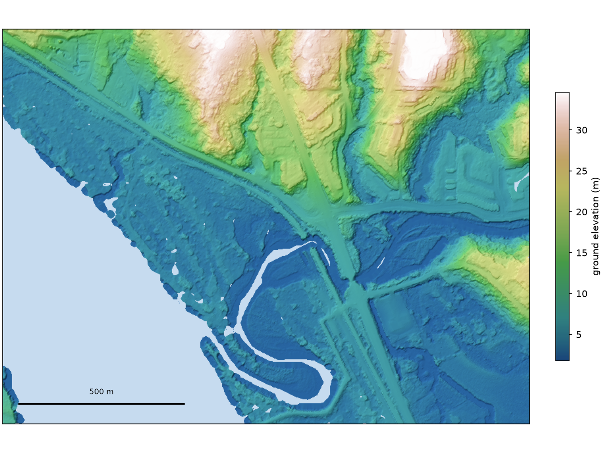
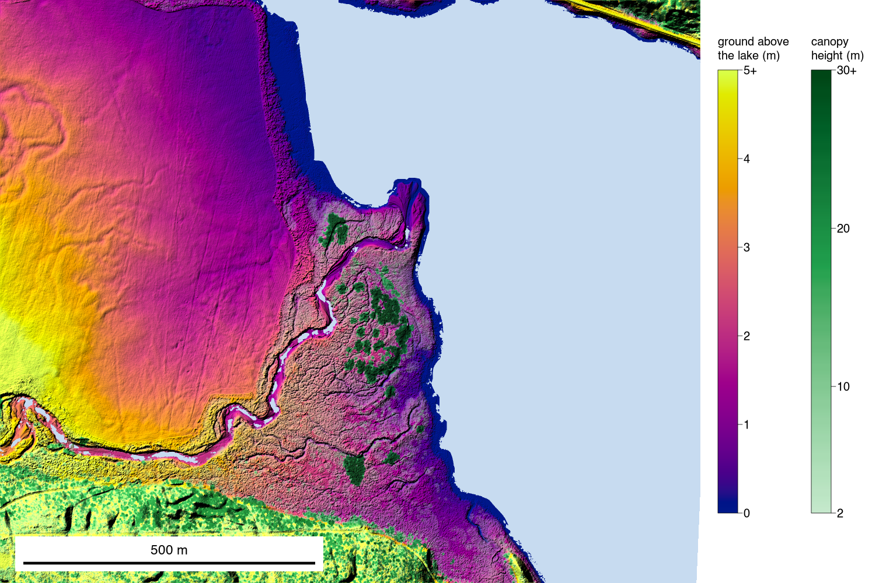

stac-pointcloud-bc
================

<!-- README.md is generated from README.Rmd. Please edit that file -->


**`stac-pointcloud-bc`** catalogues British Columbia’s [LidarBC](https://lidar.gov.bc.ca/) point clouds as a [SpatioTemporal Asset Catalog](https://stacspec.org/) (STAC): one item per `.laz` file on the province’s objectstore, so a client can find the files covering an area without downloading any of them first. Each item’s footprint, point count, point format and coordinate reference system come from the file’s own LAS header and the CRS record that follows it, read at build time with range requests; the `.laz` stays where the province publishes it, and nothing is copied. The collection holds **174,282 items in 225 mapsheet-years**. The endpoint is <https://images.a11s.one>, readable from the [`rstac`](https://brazil-data-cube.github.io/rstac/) R package, `pystac-client`, QGIS 3.42+, or any other STAC client.

## From a search to a DEM, without downloading a file



The lower Kanaka Creek where it meets the Fraser at Maple Ridge. One STAC search for a 1.6 × 1.2 km window returned 8 items from more than one flight; the 4 flown in 2016 were used. Reading only that window from each of those items’ `copc` asset transferred 74 MB of the 434 MB in those files: 6.8 million points, 1.5 million of them ground returns, gridded at 2 m into the surface above. Light blue is where no ground was returned, which here is the water. A `laz` asset has no spatial index, so the same window from it means downloading the whole file; the window read is what the `copc` asset adds. One of these 4 items returned ground points only in this window, so trees and buildings cannot be measured from it here. A LAS header does not say which classes a file holds. The build samples points from the least dense tenth of each mapsheet-year’s files, where files without ground gather, and reads whole each one a sample calls ground-only or groundless; that item lists its classes, with counts, in the `laz` asset’s `classification:classes`. In 0.3.0, 253 of them hold no ground at all, and a random 5% of the other files puts about 38 more without a list that hold no ground or only ground ([`research/laz_classes.md`](https://github.com/NewGraphEnvironment/stac_pointcloud_bc/blob/main/research/laz_classes.md)).

``` python
client = Client.open(API)
# Several deliveries can cover one place. Take the earliest item at the mouth that has a
# copc (ids sort by sheet, then year), and read only its delivery: two flights averaged
# into one grid would be neither.
at_mouth = sorted((i for i in client.search(
    collections=[COLLECTION],
    intersects={"type": "Point", "coordinates": [MOUTH_LON, MOUTH_LAT]}).items()
    if "copc" in i.assets), key=lambda i: i.id)
if not at_mouth:
    sys.exit("no item with a copc asset covers the mouth")
year = flight_year(at_mouth[0].properties)
crs = at_mouth[0].properties["proj:code"]
x0, y0 = Transformer.from_crs("EPSG:4326", crs, always_xy=True).transform(MOUTH_LON, MOUTH_LAT)
found, box = window_items(client, crs, x0, y0)
items = [i for i in found if flight_year(i.properties) == year]
if any("copc" not in i.assets for i in items):
    # A laz-only tile would have to be downloaded whole; this demo is the windowed read.
    sys.exit("an item in the window has no copc asset: " +
             ", ".join(i.id for i in items if "copc" not in i.assets))
if any(i.properties["proj:code"] != crs for i in items):
    sys.exit("items in the window do not share one CRS")

xs, ys, zs, cls = [], [], [], []
fetched = size = 0
ground_only = []
for it in items:
    f = HttpRangeFile(it.assets["copc"].href)
    with CopcReader(f) as rd:
        # Only the COPC octree nodes that meet the window are fetched.
        pts = rd.query(bounds=Bounds(mins=np.array(box[:2]), maxs=np.array(box[2:])))
    xs.append(np.asarray(pts.x))
    ys.append(np.asarray(pts.y))
    zs.append(np.asarray(pts.z))
    cls.append(np.asarray(pts.classification))
    fetched += f.bytes_fetched
    size += f.size
    if len(pts) and np.all(cls[-1] == GROUND):
        ground_only.append(it.id)
x, y, z, c = (np.concatenate(a) for a in (xs, ys, zs, cls))
```

The whole script, with the gridding, is [`scripts/readme_dem.py`](https://github.com/NewGraphEnvironment/stac_pointcloud_bc/blob/main/scripts/readme_dem.py).

## From a search to a canopy height model



The Maxan Creek delta, where the creek enters Bulkley Lake. A STAC search for a 1.2 × 1 km window, plus a 30 m margin, returned the 2 items covering it, both from the 093/093l/2019 delivery. None of them has a `copc` asset, so there is no window to read: each `laz` was downloaded whole, once, 532 MB holding 107.8 million points, of which 23.4 million fall in the window. 33% of those are ground returns (class 2) and 67% are class 1, unclassified, which is where LidarBC leaves most of its vegetation; only noise and withheld points are left out, and nothing is chosen by vegetation class. With [lidR](https://r-lidar.github.io/lidRbook/), heights are measured above a triangulated surface of the ground returns, and the first returns, ground and class 1 alike, are rasterised pit-free at 0.5 m. Open ground reads 0 m. Light blue, 41% of the window, is where no ground return lies within 5 m, or no return at all: the lake and the creek’s channel. The lake’s surface returns are class 1 and level with the ground at its shore, so without that test it would read 0 m like the meadow. Of the cells on land, 37% stand at least 2 m and 12% at least 10 m; the tallest 1% exceed 27.8 m, to a maximum of 39.5 m. LidarBC publishes its own canopy height models for 2023 and 2024 only (as of August 2026), and its DSM specifications differ between deliveries, so a DSM minus a DEM is not comparable from one delivery to the next ([stac_dem_bc#47](https://github.com/NewGraphEnvironment/stac_dem_bc/issues/47)); from the point clouds, one method serves every delivery. What this reach shows, its historic channels and the forest lost since 2017, is [floodplains#121](https://github.com/NewGraphEnvironment/floodplains/issues/121).

``` r
api <- rstac::stac(paste0(API_ROOT, "/"))
# The CRS of the delivery's tiles, from the one at the mouth.
at_mouth <- api |>
  rstac::stac_search(collections = COLLECTION, limit = 100,
                     intersects = list(type = "Point", coordinates = c(MOUTH_LON, MOUTH_LAT))) |>
  rstac::post_request()
at_mouth <- Filter(\(f) identical(f$properties[["lidarbc:delivery"]], DELIVERY),
                   at_mouth$features)
if (length(at_mouth) == 0L) stop("no ", DELIVERY, " item covers the mouth", call. = FALSE)
crs <- at_mouth[[1]]$properties[["proj:code"]]

xy <- sf::st_sfc(sf::st_point(c(MOUTH_LON, MOUTH_LAT)), crs = 4326) |>
  sf::st_transform(crs) |>
  sf::st_coordinates()
box <- c(xy[1] - WEST, xy[2] - SOUTH, xy[1] + EAST, xy[2] + NORTH)
read_box <- box + MARGIN * c(-1, -1, 1, 1)
# Search for the window and its margin: every point read has to come from a found item.
aoi <- sf::st_as_sfc(sf::st_bbox(setNames(read_box, c("xmin", "ymin", "xmax", "ymax")),
                                 crs = sf::st_crs(crs))) |>
  sf::st_transform(4326)
found <- api |>
  rstac::stac_search(collections = COLLECTION, limit = 100,
                     intersects = jsonlite::fromJSON(geojsonsf::sfc_geojson(aoi),
                                                     simplifyVector = FALSE)) |>
  rstac::post_request() |>
  rstac::items_fetch(progress = FALSE)
items <- Filter(\(f) identical(f$properties[["lidarbc:delivery"]], DELIVERY), found$features)
items <- items[order(vapply(items, \(f) f$id, ""))]
size <- vapply(items, \(f) as.numeric(f$assets$laz[["file:size"]]), 0)
if (length(items) > MAX_ITEMS || sum(size) > MAX_BYTES) {
  stop(length(items), " items, ", round(sum(size) / 1e6), " MB: more than this demo downloads",
       call. = FALSE)
}
if (any(vapply(items, \(f) f$properties[["proj:code"]] != crs, logical(1)))) {
  stop("items in the window do not share one CRS", call. = FALSE)
}
# And they must cover all of it: a tile missing from the delivery would leave part of the
# window empty, drawn as if it were water.
rect <- \(b) sf::st_as_sfc(sf::st_bbox(setNames(b, c("xmin", "ymin", "xmax", "ymax")),
                                       crs = sf::st_crs(crs)))
tiles <- sf::st_union(do.call(c, lapply(items, \(f) rect(unlist(f$properties[["proj:bbox"]])))))
if (!sf::st_covers(tiles, rect(read_box), sparse = FALSE)[1, 1]) {
  stop("the items found do not cover the window and its margin", call. = FALSE)
}

# No `copc` asset, so no window read: each file is downloaded whole, once. Refused if a
# release pairs one with a COPC, since the page then says something false.
if (any(vapply(items, \(f) !is.null(f$assets$copc), logical(1)))) {
  stop("an item in the window now has a copc asset: read the window from it", call. = FALSE)
}
laz <- vapply(seq_along(items), \(i) {
  pc_readme_laz_get(items[[i]]$assets$laz$href, size[i], LAZ_DIR)$path
}, "")
# LASlib reads only the points inside the window and its margin. pitfree() needs the
# return number: it rasterises first returns.
las <- lidR::readLAS(laz, select = "xyzrc",
                     filter = paste("-drop_withheld -keep_xy", paste(read_box, collapse = " ")))
chm <- pc_readme_chm(las, box, res = CELL, ground_gap = GROUND_GAP)
```

`pc_readme_chm()`, from [`scripts/readme_functions.R`](https://github.com/NewGraphEnvironment/stac_pointcloud_bc/blob/main/scripts/readme_functions.R):

``` r
pc_readme_chm <- function(las, box, res = 0.5, max_edge = c(2, 1.5), ground_gap = 5) {
  keep <- !las$Classification %in% NOISE_CLASSES
  if (!is.null(las$Withheld_flag)) keep <- keep & !las$Withheld_flag
  las <- lidR::filter_poi(las, keep)
  las <- lidR::normalize_height(las, lidR::tin())
  # Rasterised two cells beyond `box` and then cropped to it: the cells along the edge of a
  # triangulation come out NA. rasterize_canopy() refuses a point outside its grid.
  b <- box + 2 * res * c(-1, -1, 1, 1)
  las <- lidR::filter_poi(las, X > b[1] & X < b[3] & Y > b[2] & Y < b[4])
  grid <- terra::rast(terra::ext(b[1], b[3], b[2], b[4]), resolution = res,
                      crs = lidR::st_crs(las)$wkt)
  chm <- lidR::rasterize_canopy(
    las, grid, lidR::pitfree(thresholds = c(0, 2, 5, 10, 15, 20, 25, 30), max_edge = max_edge)
  )
  # Water: where no ground return lies within about `ground_gap` m. A lake's surface returns
  # are unclassified and sit at the height of the ground TIN across it, so they read 0 m,
  # the same as a meadow; a meadow returns ground and a lake does not.
  g <- las$Classification == 2L
  n <- tabulate(terra::cellFromXY(grid, cbind(las$X[g], las$Y[g])), terra::ncell(grid))
  # Every cell whose centre is within `ground_gap` m along x and y: that many cells each way.
  w <- 2L * as.integer(ceiling(ground_gap / res)) + 1L
  near <- terra::focal(terra::setValues(grid, n), w = w, fun = "sum", na.rm = TRUE)
  chm <- terra::mask(chm, near, maskvalues = 0)
  chm <- terra::crop(chm, terra::ext(box[1], box[3], box[2], box[4]))
  # A return a few cm under the interpolated ground is not a negative height.
  terra::clamp(chm, lower = 0, values = TRUE)
}
```

The whole script, with the figure, is [`scripts/readme_chm.R`](https://github.com/NewGraphEnvironment/stac_pointcloud_bc/blob/main/scripts/readme_chm.R).

## What an item holds

| asset | what it is |
|----|----|
| `laz` | the province’s file, on `nrs.objectstore.gov.bc.ca`. Every item has one, and it is the source of record |
| `copc` | the [Cloud Optimized Point Cloud](https://copc.io/) that Natural Resources Canada’s [CanElevation](https://open.canada.ca/data/en/dataset/7069387e-9986-4297-9f55-0288e9676947) series publishes under the same file name, where it does: **13,970 of 174,282 items** |

**A `copc` asset is linked only after its header has been checked**, not on the file name alone: the same point count, the same horizontal CRS, and a box within 0.05 m of the LidarBC file’s. That test cannot see a reclassified re-delivery published under the same name. A COPC can also be a different LAS version and point format from its source, so the item’s `pc:schemas` describe the `laz`, and the `copc` asset carries its own `las:version` and `las:point_format`. Which CanElevation projects republish LidarBC, and how that was measured, is in [`research/canelevation_overlap.md`](https://github.com/NewGraphEnvironment/stac_pointcloud_bc/blob/main/research/canelevation_overlap.md).

Items carry the [pointcloud](https://github.com/stac-extensions/pointcloud), [projection](https://github.com/stac-extensions/projection) and [file](https://github.com/stac-extensions/file) extensions. An item’s date comes from its file name where every name in the delivery agrees with its year directory: the day flown (`datetime`), or, where the name carries two days, the first and last day flown (`start_datetime` / `end_datetime`). Otherwise the item spans the directory’s year, because some deliveries name files with processing dates rather than acquisition dates. `lidarbc:datetime_source` says which, and the file name’s own date token is kept in `lidarbc:filename_date`. Each item also names its delivery, `lidarbc:delivery` (`<block>/<sheet>/<year>`, such as `092/092g/2016`), the same key [stac_dem_bc](https://github.com/NewGraphEnvironment/stac_dem_bc) writes on the DEM and DSM items of that delivery, and the collection links `stac-elevation-bc` as `related`. Releases up to 0.2.0 published the custom fields with an `nge:` prefix; 0.3.0 renamed them ([\#12](https://github.com/NewGraphEnvironment/stac_pointcloud_bc/issues/12); [NEWS.md](https://github.com/NewGraphEnvironment/stac_pointcloud_bc/blob/main/NEWS.md) has each old and new name).

## What is indexed

Every `<block>/<sheet>/<year>/pointcloud/*.laz` on the province’s objectstore, less two sets. Eleven files are excluded by name, each with its reason: four hold 0 or 1 points, three have a box no tile could have (hundreds or thousands of kilometres across), three sit outside the mapsheet their path names, and one declares a CRS its file name contradicts. And 985 files in eight 2017 deliveries state no CRS at all; indexing them from the CRS their delivery’s DEM declares is [\#15](https://github.com/NewGraphEnvironment/stac_pointcloud_bc/issues/15). The `dsm/*.laz` are not indexed: in every tile compared they were an RGB-colourised copy of the point cloud, not a surface model ([\#3](https://github.com/NewGraphEnvironment/stac_pointcloud_bc/issues/3), [`research/laz_header_read.md`](https://github.com/NewGraphEnvironment/stac_pointcloud_bc/blob/main/research/laz_header_read.md)). [NEWS.md](https://github.com/NewGraphEnvironment/stac_pointcloud_bc/blob/main/NEWS.md) says what each release published.

| mapsheet / year | items | with copc |        points |
|:----------------|------:|----------:|--------------:|
| 082e/2017       |   359 |           |   3.5 billion |
| 082e/2018       | 1,995 |           | 120.2 billion |
| 082e/2019       |   871 |       332 |  51.0 billion |
| 082e/2022       |    30 |           |   2.5 billion |
| 082e/2024       | 2,051 |           | 320.8 billion |
| 082e/2025       | 3,460 |           | 482.9 billion |
| 082f/2015       |   145 |           |   3.7 billion |
| 082f/2016       |   100 |           |   2.3 billion |
| 082f/2017       | 2,772 |           |  75.0 billion |
| 082f/2018       | 1,061 |           |  67.8 billion |
| 082f/2022       | 1,669 |           | 175.0 billion |
| 082f/2024       |   247 |           |  43.7 billion |
| 082f/2025       |    97 |           |  16.4 billion |
| 082g/2015       |   212 |           |   4.2 billion |
| 082g/2016       | 2,149 |           |  40.2 billion |
| 082g/2017       |   373 |           |   7.5 billion |
| 082g/2018       |   215 |           |  10.9 billion |
| 082g/2022       | 1,637 |           | 146.0 billion |
| 082g/2024       |   733 |           |  76.9 billion |
| 082g/2025       |   433 |           |  71.6 billion |
| 082j/2015       | 1,422 |           |  30.9 billion |
| 082j/2016       |    47 |           |   0.8 billion |
| 082j/2017       |   441 |           |   8.2 billion |
| 082j/2018       |   207 |           |  11.1 billion |
| 082j/2022       |   504 |           |  32.3 billion |
| 082k/2015       | 1,534 |           |  32.2 billion |
| 082k/2017       |   267 |           |   7.5 billion |
| 082k/2018       |   289 |           |  20.3 billion |
| 082k/2021       |    95 |           |   5.7 billion |
| 082k/2022       |    63 |           |   6.5 billion |
| 082l/2017       |   269 |           |   2.8 billion |
| 082l/2018       |   774 |           |  43.3 billion |
| 082l/2019       | 1,352 |        57 | 101.0 billion |
| 082l/2021       |   132 |           |   6.8 billion |
| 082l/2022       |   132 |           |  13.9 billion |
| 082l/2024       |   874 |           | 161.6 billion |
| 082l/2025       |   939 |           | 151.9 billion |
| 082m/2019       |   754 |        23 |  47.0 billion |
| 082m/2020       |    35 |           |   2.0 billion |
| 082m/2021       |     7 |           |   0.2 billion |
| 082m/2022       |   221 |           |  35.7 billion |
| 082n/2015       |   365 |           |   6.8 billion |
| 082n/2021       |   279 |           |  19.7 billion |
| 082n/2022       |    32 |           |   3.7 billion |
| 083d/2019       |   593 |       154 |  36.9 billion |
| 083d/2020       |   485 |           |  23.1 billion |
| 083d/2021       |    30 |           |   2.1 billion |
| 083d/2022       |    29 |           |   3.1 billion |
| 083e/2019       |   116 |       116 |   3.3 billion |
| 092a/2016       |    17 |           |   0.0 billion |
| 092b/2019       | 1,230 |     1,132 |  68.6 billion |
| 092b/2021       |    66 |           |   0.9 billion |
| 092b/2023       |   854 |           | 118.8 billion |
| 092b/2024       |   651 |           |  87.6 billion |
| 092c/2019       | 1,245 |     1,071 |  82.5 billion |
| 092c/2023       | 1,045 |           | 215.4 billion |
| 092c/2024       |    53 |           |   7.1 billion |
| 092e/2012       |     6 |           |   0.0 billion |
| 092e/2019       |   464 |       462 |  28.8 billion |
| 092f/2018       |   276 |       136 |  13.9 billion |
| 092f/2019       | 2,394 |     2,239 | 129.4 billion |
| 092f/2020       |   156 |           |   7.5 billion |
| 092f/2022       |    42 |           |   2.8 billion |
| 092f/2023       |   247 |           |  32.1 billion |
| 092f/2024       | 1,071 |           | 153.8 billion |
| 092f/2025       |    15 |           |   2.0 billion |
| 092g/2016       | 1,706 |     1,155 |  58.8 billion |
| 092g/2017       |   209 |           |   8.6 billion |
| 092g/2018       |   338 |           |  14.0 billion |
| 092g/2019       |   968 |       627 |  58.5 billion |
| 092g/2020       |   835 |           |  62.8 billion |
| 092g/2021       |   174 |           |   3.9 billion |
| 092g/2023       |   428 |           |  41.1 billion |
| 092g/2024       |   854 |           | 102.4 billion |
| 092g/2025       |   359 |           |  23.9 billion |
| 092h/2016       | 1,019 |       420 |  48.5 billion |
| 092h/2017       |   471 |           |  18.4 billion |
| 092h/2018       |    33 |           |   1.1 billion |
| 092h/2019       |   560 |       317 |  27.1 billion |
| 092h/2020       |    55 |           |   2.6 billion |
| 092h/2021       |   406 |           |  23.5 billion |
| 092h/2022       |   189 |           |  26.7 billion |
| 092h/2023       |   173 |           |  20.7 billion |
| 092h/2025       |    56 |           |   7.2 billion |
| 092i/2017       |     2 |           |   0.0 billion |
| 092i/2018       |   235 |           |   7.6 billion |
| 092i/2019       |   731 |        42 |  38.0 billion |
| 092i/2020       |    76 |           |   3.8 billion |
| 092i/2021       |   345 |           |  19.0 billion |
| 092i/2022       |    75 |           |   7.8 billion |
| 092i/2024       |   521 |           |  85.7 billion |
| 092j/2016       |   182 |           |   4.0 billion |
| 092j/2017       |   319 |           |   8.1 billion |
| 092j/2018       |    28 |           |   0.9 billion |
| 092j/2019       |   198 |         3 |   6.8 billion |
| 092j/2020       |   610 |           |  34.9 billion |
| 092j/2022       |    97 |           |  19.3 billion |
| 092k/2018       |   320 |       231 |  22.2 billion |
| 092k/2019       |   305 |       285 |  18.0 billion |
| 092k/2020       |   821 |           |  44.6 billion |
| 092k/2023       |   238 |           |  28.8 billion |
| 092k/2024       |   943 |           | 121.4 billion |
| 092k/2025       |    37 |           |   6.1 billion |
| 092l/2012       |   415 |           |  11.1 billion |
| 092l/2019       | 1,367 |     1,292 |  84.9 billion |
| 092l/2020       |   155 |           |   8.0 billion |
| 092l/2023       |   714 |           |  75.1 billion |
| 092l/2024       |   130 |           |  22.0 billion |
| 092m/2023       |     5 |           |   0.0 billion |
| 092n/2020       |    30 |           |   1.2 billion |
| 092n/2023       |   750 |           | 104.3 billion |
| 092n/2024       |    64 |           |   5.0 billion |
| 092o/2018       |   229 |           |   8.5 billion |
| 092o/2019       |   644 |           |  29.7 billion |
| 092o/2023       |   991 |           | 120.1 billion |
| 092o/2024       | 1,123 |           | 123.9 billion |
| 092p/2017       |   335 |           |   9.9 billion |
| 092p/2019       | 3,328 |           | 179.7 billion |
| 092p/2020       |    42 |           |   2.1 billion |
| 092p/2021       |   157 |           |   7.4 billion |
| 092p/2022       |    89 |           |   5.5 billion |
| 092p/2024       | 3,854 |           | 364.6 billion |
| 092p/2025       |    31 |           |   2.6 billion |
| 093a/2019       |   286 |        12 |  12.3 billion |
| 093a/2020       |     9 |           |   0.0 billion |
| 093a/2021       |   156 |           |   8.7 billion |
| 093a/2024       | 1,112 |           | 100.1 billion |
| 093b/2019       |   734 |       406 |  32.4 billion |
| 093b/2023       | 3,340 |           | 337.2 billion |
| 093b/2024       | 2,640 |           | 272.6 billion |
| 093c/2019       |     2 |           |   0.0 billion |
| 093c/2023       | 2,969 |           | 315.4 billion |
| 093c/2024       | 1,700 |           | 128.0 billion |
| 093d/2019       |   142 |           |   6.2 billion |
| 093e/2018       |    52 |           |   1.9 billion |
| 093e/2025       |    87 |           |   5.2 billion |
| 093f/2019       |   241 |       241 |   7.7 billion |
| 093f/2024       | 3,587 |           | 363.2 billion |
| 093f/2025       |   977 |           |  86.4 billion |
| 093g/2019       | 1,261 |     1,261 |  63.5 billion |
| 093g/2023       |     4 |           |   0.5 billion |
| 093g/2024       | 4,998 |           | 552.9 billion |
| 093g/2025       |   636 |           |  76.5 billion |
| 093h/2019       |   430 |       429 |  13.7 billion |
| 093h/2021       |   633 |           |  51.9 billion |
| 093h/2022       |   341 |           |  19.3 billion |
| 093h/2024       |    86 |           |   8.4 billion |
| 093h/2025       |   241 |           |  24.3 billion |
| 093i/2017       |     4 |           |   0.0 billion |
| 093i/2018       |   222 |           |   7.8 billion |
| 093i/2019       |   179 |       179 |   5.7 billion |
| 093i/2021       |   466 |           |  29.8 billion |
| 093i/2024       |   759 |           |  76.5 billion |
| 093i/2025       |   698 |           |  76.6 billion |
| 093j/2017       |   228 |           |   7.2 billion |
| 093j/2019       |   501 |       501 |  25.0 billion |
| 093j/2020       |   392 |           |  20.5 billion |
| 093j/2021       |    27 |           |   0.8 billion |
| 093j/2022       |    33 |           |   1.5 billion |
| 093j/2024       | 3,399 |           | 243.7 billion |
| 093j/2025       | 2,298 |           | 194.8 billion |
| 093k/2019       |   475 |       475 |  25.6 billion |
| 093k/2020       |   708 |           |  40.0 billion |
| 093k/2021       |   283 |           |  18.9 billion |
| 093k/2022       |   171 |           |   9.1 billion |
| 093k/2024       | 3,268 |           | 276.4 billion |
| 093k/2025       |   489 |           |  46.0 billion |
| 093l/2016       |   549 |           |  21.8 billion |
| 093l/2018       |   552 |           |  26.9 billion |
| 093l/2019       |   490 |           |  19.2 billion |
| 093m/2016       |    84 |           |   2.9 billion |
| 093m/2018       |   426 |           |  25.5 billion |
| 093m/2019       |   291 |           |  12.8 billion |
| 093m/2020       |   356 |           |  21.5 billion |
| 093m/2021       |    18 |           |   0.4 billion |
| 093n/2020       |   466 |           |  21.8 billion |
| 093n/2021       |   758 |           |  45.1 billion |
| 093n/2022       |   301 |           |  13.3 billion |
| 093n/2025       | 1,346 |           | 107.7 billion |
| 093o/2017       |    58 |           |   1.3 billion |
| 093o/2018       |   241 |           |   8.4 billion |
| 093o/2022       |    29 |           |   1.7 billion |
| 093o/2025       | 2,112 |           | 198.2 billion |
| 093p/2018       |   271 |           |   9.5 billion |
| 093p/2021       |   702 |           |  52.9 billion |
| 093p/2024       | 3,538 |           | 299.6 billion |
| 093p/2025       | 2,092 |           | 273.4 billion |
| 094a/2024       | 6,122 |           | 389.0 billion |
| 094a/2025       |   328 |           |  42.7 billion |
| 094b/2024       | 1,018 |           |  83.4 billion |
| 094b/2025       |   865 |           |  87.1 billion |
| 094c/2025       |   108 |           |   5.3 billion |
| 094g/2024       | 3,044 |           | 243.6 billion |
| 094g/2025       |   174 |           |  14.5 billion |
| 094h/2024       | 6,269 |           | 393.2 billion |
| 094i/2024       | 5,813 |           | 290.9 billion |
| 094i/2025       |   440 |           |  22.3 billion |
| 094j/2024       | 3,483 |           | 273.7 billion |
| 094j/2025       |   853 |           |  72.5 billion |
| 094n/2024       | 1,100 |           |  89.5 billion |
| 094n/2025       |   319 |           |  35.1 billion |
| 094o/2024       | 5,913 |           | 433.7 billion |
| 094o/2025       |   178 |           |  11.5 billion |
| 094o/2026       |     1 |           |   0.1 billion |
| 094p/2024       | 3,747 |           | 187.1 billion |
| 094p/2025       | 2,574 |           | 107.9 billion |
| 102i/2012       |   213 |           |   5.5 billion |
| 102i/2019       |   373 |       372 |  23.2 billion |
| 102i/2023       |   528 |           |  51.2 billion |
| 102i/2024       |    34 |           |   4.1 billion |
| 103a/2021       |   114 |           |   8.7 billion |
| 103h/2019       |    30 |           |   0.8 billion |
| 103h/2021       |    69 |           |   4.1 billion |
| 103i/2016       |   125 |           |   4.4 billion |
| 103i/2019       |   522 |           |  28.1 billion |
| 103i/2021       |   600 |           |  32.7 billion |
| 103i/2022       |   335 |           |  22.0 billion |
| 103j/2021       |     2 |           |   0.0 billion |
| 103o/2019       |     3 |           |   0.0 billion |
| 103p/2018       |    91 |           |   5.8 billion |
| 103p/2019       |   436 |           |  17.1 billion |
| 103p/2020       |    87 |           |   5.6 billion |
| 103p/2022       |   171 |           |   9.9 billion |
| 104a/2019       |    16 |           |   0.4 billion |
| 104k/2021       |   143 |           |   7.7 billion |

Catalogue version 0.3.0, read from the API on 2026-10-11. Every id the bucket’s collection.json links was served by the API, and nothing else was.

## Query it

Use [`bcdata`](https://github.com/bcgov/bcdata) for an area of interest and `rstac` to search the collection for the items intersecting it. Below: every indexed point cloud in the Similkameen River watershed group.

``` r
# Freshwater Atlas watershed groups, by the record's permanent id.
aoi <- bcdata::bcdc_query_geodata("51f20b1a-ab75-42de-809d-bf415a0f9c62") |>
  bcdata::filter(WATERSHED_GROUP_CODE == "SIML") |>
  bcdata::collect() |>
  sf::st_transform(crs = 4326)

r <- rstac::stac("https://images.a11s.one/") |>
  rstac::stac_search(
    collections = "stac-pointcloud-bc",
    intersects = jsonlite::fromJSON(
      geojsonsf::sf_geojson(aoi, atomise = TRUE, simplify = FALSE),
      simplifyVector = FALSE
    )$geometry,
    limit = 1000
  ) |>
  rstac::post_request() |>
  rstac::items_fetch()
```

**1,428 items**, 530 of them with a `copc` asset. A sample of 10 is below, 5 with a copc asset and 5 without; every one, with download links for both assets, is in the table at <https://www.newgraphenvironment.com/stac_pointcloud_bc/>.

| item | points | laz | copc |
|:---|---:|:---|:---|
| 082-082e-2019-pointcloud-bc_082e002_1_2_1_xyes_8_utm11_2019 | 12,568,291 | [bc_082e002_1_2_1_xyes_8_utm11_2019.laz](https://nrs.objectstore.gov.bc.ca/gdwuts/082/082e/2019/pointcloud/bc_082e002_1_2_1_xyes_8_utm11_2019.laz) | [bc_082e002_1_2_1_xyes_8_utm11_2019.copc.laz](https://canelevation-lidar-point-clouds.s3.ca-central-1.amazonaws.com/pointclouds_nuagespoints/BC/Riverine_Floodplain_UTM11_2019/bc_082e002_1_2_1_xyes_8_utm11_2019.copc.laz) |
| 082-082e-2019-pointcloud-bc_082e002_1_2_2_xyes_8_utm11_2019 | 41,779,961 | [bc_082e002_1_2_2_xyes_8_utm11_2019.laz](https://nrs.objectstore.gov.bc.ca/gdwuts/082/082e/2019/pointcloud/bc_082e002_1_2_2_xyes_8_utm11_2019.laz) | [bc_082e002_1_2_2_xyes_8_utm11_2019.copc.laz](https://canelevation-lidar-point-clouds.s3.ca-central-1.amazonaws.com/pointclouds_nuagespoints/BC/Riverine_Floodplain_UTM11_2019/bc_082e002_1_2_2_xyes_8_utm11_2019.copc.laz) |
| 082-082e-2019-pointcloud-bc_082e002_1_2_3_xyes_8_utm11_2019 | 18,773,358 | [bc_082e002_1_2_3_xyes_8_utm11_2019.laz](https://nrs.objectstore.gov.bc.ca/gdwuts/082/082e/2019/pointcloud/bc_082e002_1_2_3_xyes_8_utm11_2019.laz) | [bc_082e002_1_2_3_xyes_8_utm11_2019.copc.laz](https://canelevation-lidar-point-clouds.s3.ca-central-1.amazonaws.com/pointclouds_nuagespoints/BC/Riverine_Floodplain_UTM11_2019/bc_082e002_1_2_3_xyes_8_utm11_2019.copc.laz) |
| 082-082e-2019-pointcloud-bc_082e002_1_2_4_xyes_8_utm11_2019 | 45,334,959 | [bc_082e002_1_2_4_xyes_8_utm11_2019.laz](https://nrs.objectstore.gov.bc.ca/gdwuts/082/082e/2019/pointcloud/bc_082e002_1_2_4_xyes_8_utm11_2019.laz) | [bc_082e002_1_2_4_xyes_8_utm11_2019.copc.laz](https://canelevation-lidar-point-clouds.s3.ca-central-1.amazonaws.com/pointclouds_nuagespoints/BC/Riverine_Floodplain_UTM11_2019/bc_082e002_1_2_4_xyes_8_utm11_2019.copc.laz) |
| 082-082e-2019-pointcloud-bc_082e002_1_4_1_xyes_8_utm11_2019 | 15,093,616 | [bc_082e002_1_4_1_xyes_8_utm11_2019.laz](https://nrs.objectstore.gov.bc.ca/gdwuts/082/082e/2019/pointcloud/bc_082e002_1_4_1_xyes_8_utm11_2019.laz) | [bc_082e002_1_4_1_xyes_8_utm11_2019.copc.laz](https://canelevation-lidar-point-clouds.s3.ca-central-1.amazonaws.com/pointclouds_nuagespoints/BC/Riverine_Floodplain_UTM11_2019/bc_082e002_1_4_1_xyes_8_utm11_2019.copc.laz) |
| 082-082e-2018-pointcloud-bc_082e002_4_4_4_xyes_12_utm11_2018 | 110,649,896 | [bc_082e002_4_4_4_xyes_12_utm11_2018.laz](https://nrs.objectstore.gov.bc.ca/gdwuts/082/082e/2018/pointcloud/bc_082e002_4_4_4_xyes_12_utm11_2018.laz) |  |
| 082-082e-2018-pointcloud-bc_082e003_1_2_2_xyes_12_utm11_2018 | 44,603,740 | [bc_082e003_1_2_2_xyes_12_utm11_2018.laz](https://nrs.objectstore.gov.bc.ca/gdwuts/082/082e/2018/pointcloud/bc_082e003_1_2_2_xyes_12_utm11_2018.laz) |  |
| 082-082e-2018-pointcloud-bc_082e003_1_2_3_xyes_12_utm11_2018 | 59,624,858 | [bc_082e003_1_2_3_xyes_12_utm11_2018.laz](https://nrs.objectstore.gov.bc.ca/gdwuts/082/082e/2018/pointcloud/bc_082e003_1_2_3_xyes_12_utm11_2018.laz) |  |
| 082-082e-2018-pointcloud-bc_082e003_1_2_4_xyes_12_utm11_2018 | 53,470,524 | [bc_082e003_1_2_4_xyes_12_utm11_2018.laz](https://nrs.objectstore.gov.bc.ca/gdwuts/082/082e/2018/pointcloud/bc_082e003_1_2_4_xyes_12_utm11_2018.laz) |  |
| 082-082e-2018-pointcloud-bc_082e003_1_3_4_xyes_12_utm11_2018 | 56,097,375 | [bc_082e003_1_3_4_xyes_12_utm11_2018.laz](https://nrs.objectstore.gov.bc.ca/gdwuts/082/082e/2018/pointcloud/bc_082e003_1_3_4_xyes_12_utm11_2018.laz) |  |

### Read a header without downloading the file

A LAS file starts with a public header, at most 375 bytes, holding its version, point format, point count and bounding box. One HTTP range request reads it from either asset, whatever the file’s size. `pc_readme_header()` in [`scripts/readme_functions.R`](https://github.com/NewGraphEnvironment/stac_pointcloud_bc/blob/main/scripts/readme_functions.R) does it with `httr2` and base R, with no LAS library, and checks the result against the item:

``` r
it <- r$features[order(vapply(r$features, \(f) f$id, ""))] |>
  Filter(f = \(f) !is.null(f$assets$copc)) |>
  (\(x) x[[1]])()

h_laz <- pc_readme_header(it$assets$laz$href)
h_copc <- pc_readme_header(it$assets$copc$href)

# Same point count as the item's `pc:count`, and a box within 0.05 m of its `proj:bbox`.
off_laz <- pc_readme_header_check(h_laz, it)
off_copc <- pc_readme_header_check(h_copc, it)
```

| field                          |                   laz |                  copc |
|:-------------------------------|----------------------:|----------------------:|
| LAS version                    |                   1.4 |                   1.4 |
| point format                   |                     6 |                     6 |
| points                         |            12,568,291 |            12,568,291 |
| min x, y                       | 300151.00, 5431033.85 | 300151.00, 5431033.85 |
| max x, y                       | 300746.43, 5432444.86 | 300746.43, 5432444.86 |
| offset from the item’s box (m) |                 0.000 |                 0.000 |
| bytes read / file size         |      375 / 51,835,294 |      375 / 77,720,976 |

The item is 082-082e-2019-pointcloud-bc_082e002_1_2_1_xyes_8_utm11_2019. Both files are LAS 1.4 point format 6, with the same count and box: CanElevation’s copy of the province’s file, reorganised as a COPC so a client can read one region or one level of detail without the rest.

## Sister collections on the same endpoint

- [`stac_dem_bc`](https://github.com/NewGraphEnvironment/stac_dem_bc) — the DEM and DSM rasters of the same LidarBC deliveries (`stac-elevation-bc`)
- [`stac_floodplains_bc`](https://github.com/NewGraphEnvironment/stac_floodplains_bc) — floodplain land-cover change (`stac-floodplains-bc`)
- [`stac_airphoto_bc`](https://github.com/NewGraphEnvironment/stac_airphoto_bc) — historic airphoto thumbnails, 1963–2019 (`stac-airphoto-bc`)
- [`stac_uav_bc`](https://github.com/NewGraphEnvironment/stac_uav_bc) — UAV imagery, organized by watershed (`imagery-uav-bc-prod`)

## Build, publish, register

The catalogue is built in Python. Each item is created by a pure function from a file’s href and header (`scripts/laz_item.py`), the item JSON is published to `s3://stac-pointcloud-bc`, and [stacs](https://github.com/NewGraphEnvironment/stacs) registers and verifies it (`stacs.toml`).

``` bash
uv sync
uv run pytest tests/ -q
PYTHONPATH=scripts uv run python scripts/catalogue_build.py        # -> data/build/
uv run python scripts/collection_version.py --version X.Y.Z        # release only
bash scripts/s3_sync.sh --dryrun && bash scripts/s3_sync.sh        # items, then collection.json
uv run stacs verify --config stacs.toml
uv run stacs register --config stacs.toml --mode drift            # from a tailnet machine
```

`catalogue_build.py --limit N` writes to `data/build-limit/`, never `data/build/`, so a development build cannot be published.

This page is R. [`scripts/DESCRIPTION`](https://github.com/NewGraphEnvironment/stac_pointcloud_bc/blob/main/scripts/DESCRIPTION) lists its packages; it is a manifest, not a package.

``` bash
Rscript -e 'pak::local_install_dev_deps("scripts")'
Rscript -e 'testthat::test_file("tests/readme_functions_test.R")'
```

The DEM demo is Python, in its own dependency group: `uv sync --group readme`. The CHM demo is R. Then run the two `rmarkdown::render()` calls in the `build` chunk at the top of `README.Rmd`: the `README.md` render with `update_query = TRUE` queries the API, runs `scripts/readme_dem.py` and `scripts/readme_chm.R`, and refreshes `data/readme_cache.rds`, `data/readme_dem.json`, `fig/kanaka_dem.png`, `data/readme_chm.json` and `fig/maxan_chm.png`; the `index.html` render reads them. The CHM demo’s first run downloads about 0.5 GB of `.laz` into `data/readme_laz/` (not committed), and later runs reuse it. [research/](https://github.com/NewGraphEnvironment/stac_pointcloud_bc/blob/main/research/README.md) holds what is known about the source and how it was measured.

## Licence

The scripts are [MIT](https://github.com/NewGraphEnvironment/stac_pointcloud_bc/blob/main/LICENSE). The catalogue is published as `CC-BY-4.0`, with the Province of British Columbia as producer and licensor, NRCan as a host and New Graph Environment as processor (the collection’s `license` and `providers`, in its [collection.json](https://stac-pointcloud-bc.s3.us-west-2.amazonaws.com/collection.json)). Each `copc` asset is distributed by NRCan under the Open Government Licence – Canada, as its description says.
